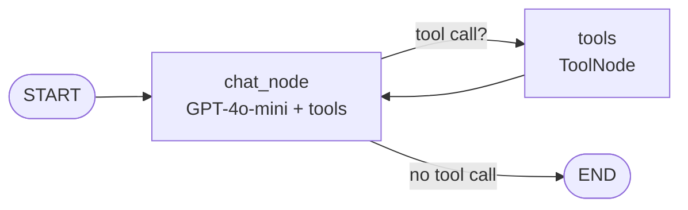

# HITL-Chatbot-Usin LangGraph

# StockPilot

A conversational stock assistant built with **LangGraph**, **OpenAI** and **Streamlit**. Ask for live stock prices in plain English, or place a simulated order. The agent pauses before every purchase and waits for your explicit approval (human-in-the-loop).

## Features

- **Natural-language chat.** Ask things like "What's the price of AAPL?" or "Buy 10 shares of MSFT".
- **Live quotes.** Prices come from the Alpha Vantage `GLOBAL_QUOTE` endpoint and are shown as a clean card with price, change, open, day high, day low, volume and previous close.
- **Human-in-the-loop approval.** `purchase_stock` calls LangGraph's `interrupt()`, so the graph stops until you click "Yes, place the order" or "No, cancel it".
- **Conversation memory.** Each chat session has its own `thread_id`, and the graph is compiled with a `MemorySaver` checkpointer so follow-up questions keep their context.
- **Custom UI.** A friendly light theme built with custom CSS and inline SVG icons on top of Streamlit, with a status indicator, quick-question shortcuts and a "new conversation" button.
- **Command-line mode.** `backend.py` also runs as a terminal chat with the same approval flow.

## How it works



| Component | Role |
|-----------|------|
| `chat_node` | Calls `gpt-4o-mini` with the two tools bound. It either answers or requests a tool call. |
| `get_stock_price` | Fetches a live quote from Alpha Vantage. |
| `purchase_stock` | Simulates a purchase. Calls `interrupt(...)` first and only continues when resumed with `"yes"`. |
| `ToolNode` and `tools_condition` | Run the requested tool and route back to the chat node. |
| `MemorySaver` | In-memory checkpointer that stores state per `thread_id` and makes pausing and resuming possible. |

**Approval flow in the UI**

1. You send a message such as "Buy 5 shares of NVDA".
2. The graph runs and `purchase_stock` raises an interrupt. `chatbot.invoke(...)` returns with `__interrupt__` in the result.
3. The frontend parses the prompt and shows a confirmation card. Chat input is disabled while it waits.
4. Your click resumes the graph with `Command(resume="yes")` or `Command(resume="no")`.
5. The result appears as an order banner, followed by the assistant's final reply.

## Tech stack

- Python 3.10+
- [LangGraph](https://github.com/langchain-ai/langgraph) for the agent graph, checkpointing and interrupts
- [LangChain](https://github.com/langchain-ai/langchain) with `langchain-openai` for the model and tools
- [Streamlit](https://streamlit.io) for the web interface
- [Alpha Vantage](https://www.alphavantage.co) for market data

## Project structure

```
.
├── backend.py            # LangGraph agent, tools and CLI chat loop
├── frontend.py           # Streamlit UI (custom CSS and HTML)
├── .streamlit/
│   └── config.toml       # Light theme settings
├── requirements.txt      # Python dependencies
├── .env                  # Your API keys (not committed)
└── README.md
```

## Getting started

### 1. Clone the repository

```bash
git clone https://github.com/<your-username>/<your-repo>.git
cd <your-repo>
```

### 2. Create a virtual environment and install dependencies

```bash
python -m venv .venv
source .venv/bin/activate        # Windows: .venv\Scripts\activate
pip install -r requirements.txt
```

If you do not have a `requirements.txt` yet, create one with:

```
streamlit
langgraph
langchain-core
langchain-openai
python-dotenv
requests
```

### 3. Add your API keys

Create a `.env` file in the project root:

```
OPENAI_API_KEY=your-openai-key
ALPHAVANTAGE_API_KEY=your-alpha-vantage-key
```

You can get a free Alpha Vantage key at <https://www.alphavantage.co/support/#api-key>.

Make sure `backend.py` reads the Alpha Vantage key from the environment instead of a hardcoded value:

```python
import os

url = (
    "https://www.alphavantage.co/query"
    f"?function=GLOBAL_QUOTE&symbol={symbol}&apikey={os.getenv('ALPHAVANTAGE_API_KEY')}"
)
```

Add `.env` to your `.gitignore` so keys are never committed.

### 4. Run the app

**Web interface**

```bash
streamlit run frontend.py
```

Then open the local URL Streamlit prints, usually <http://localhost:8501>.

**Terminal mode**

```bash
python backend.py
```

Type a message, answer `yes` or `no` when asked to approve a purchase, and type `exit` to quit.

## Example prompts

- `What's the price of AAPL?`
- `Show me TSLA's latest quote`
- `Buy 10 shares of MSFT`
- `Check NVDA and buy 5 shares`

## Customization

- **Model:** change `ChatOpenAI(model='gpt-4o-mini')` in `backend.py`.
- **New tools:** add a function with the `@tool` decorator and include it in the `tools` list. To show a custom card for it, add a branch in `render_event` in `frontend.py`.
- **Look and feel:** colors, fonts and spacing are CSS variables at the top of `CUSTOM_CSS` in `frontend.py`, and theme defaults are in `.streamlit/config.toml`.
- **Persistence:** swap `MemorySaver` for `SqliteSaver` or `PostgresSaver` so conversations survive restarts.

## Limitations

- Purchases are **simulated**. No real orders are placed and no brokerage is connected.
- The Alpha Vantage free tier is rate limited. When the limit is hit, the UI shows a "could not get that quote" card.
- `MemorySaver` keeps state in memory only, so conversations are lost when the server restarts.
- This project is for learning and demonstration. It is not financial advice.

## Contributing

Issues and pull requests are welcome. For larger changes, please open an issue first to discuss what you would like to change.

## License

Add a license of your choice, for example MIT, by creating a `LICENSE` file in the repository root.
